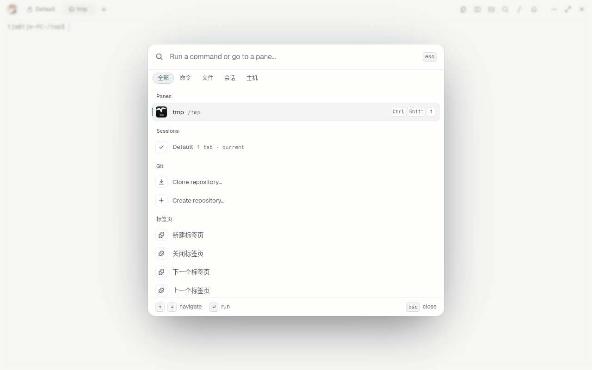

# tern-zh-cn

[Tern](https://stencil.so/tern) 简体中文插件，基于 [maicent/tern-zh-cn](https://github.com/maicent/tern-zh-cn) 的 fork。0.3.0 新增 **独立原生中文设置页面**：分类、完整说明、当前值、直接开关与编辑入口，适配 Tern 0.9.5。

## 安装 / 从原版升级

```sh
tern plugin install github.com/Gyarados4157/tern-zh-cn --force
```

也可以在 Settings › Plugins 安装该 GitHub 地址。插件 ID 沿用 `zh-cn`，替换原版而不是同时运行两份；`--force` 会覆盖已安装的同 ID 插件副本，不改变 Tern 设置。若原来使用 `plugin link`，先取消原来的链接再安装。更新后在命令面板执行 Reload plugins（重新加载插件），必要时重开窗口。

## 中文设置

1. 按 macOS **⇧⌘P**（其他平台 Ctrl+Shift+P）打开命令面板。
2. 搜索 **中文设置**，选择“中文设置：打开设置页面…”。页面在独立标签页打开，重复打开会聚焦已有页面。
3. 左侧切换 16 个分类；窄窗口将分类排列在顶部。每项直接显示中文说明、原始设置键和当前值。
4. 开关直接点击生效；其他项点“修改…”打开原生选择器或输入框。输入值后确认保存；恢复默认也会先确认。Esc 取消。
5. 点“搜索设置…”按中文名称、说明或英文设置键全局搜索。每页最多显示 40 项，更多结果可翻页。点“刷新当前值”同步其他窗口的修改；点“英文原设置”打开原页面。

原来的“中文设置：搜索全部设置…”与分类选择器仍可使用。插件页面禁止内嵌 input/editor，所以文字、数字和 JSON 使用弹出输入框，而不是伪造不可编辑的表单。

修改通过 `cx.settings:set` 的正常校验、应用和保存路径，不直接改写 settings.json。重启后生效的选项仍需重启；本机与远程设置的作用范围沿用 Tern 自身行为。终端历史行数等设置会立即影响运行状态，修改前请看说明。

### 输入规则

- **开关 / 枚举**：选择列表中的值；原始枚举值作为辅助文字保留，避免歧义。
- **整数 / 数字**：输入 JSON 数字，整数项拒绝小数；具体有效范围由 Tern 校验并可能钳制，保存通知显示实际值。
- **字符串**：直接输入文字，不加 JSON 双引号；清空保存为空字符串，不等于恢复默认。
- **数组 / 对象 / 混合类型**：输入合法 JSON，字符串需要双引号。格式、字段与类型由 Tern 再次校验。不熟悉复杂结构时建议使用原生设置编辑器。
- **可空设置**：枚举中提供“自动 / 未设置”，复杂输入可用 `null` 清除。恢复默认值使用运行时给出的默认值，不在插件里复制一套默认配置。

中文名称与解释位于 `locales/zh-cn.luau`；实际键、类型、枚举、范围与默认值由当前运行的 Tern API 提供。未进入词典的新版本设置不会冒充已经翻译。

0.2.0 词典覆盖 Tern 0.9.5 的全部 297 个设置叶键、16 个分类。已在独立配置的真实 macOS Tern 窗口验证：中文搜索、分类入口、开关关闭/开启、枚举写入、整数保存与小数拒绝、取消修改、恢复默认值及取消恢复、字符串保存、可空数字、无效 JSON 不修改原值、完整中文说明阅读。

## 保留的汉化功能

- 中文常用命令包装：搜索“新建标签页”“向右拆分”“设置”等。
- CSS 静态替换：命令面板分类（全部、命令、文件、会话、主机）和部分标签栏文字。



## 能力边界

**这不是 Tern 原生 i18n 语言包，不会把内置 Settings 页面变成中文。** Tern 0.9.5 的插件接口没有内置字符串翻译钩子；其设置页标签也没有足够稳定的设置键属性。按行号覆盖会在搜索、条件变化或升级后把解释贴到错误设置，因此不采用。

- 中文入口由插件提供，原生英文设置页仍可使用。
- 原生设置搜索仍按英文；中文搜索在新增入口内进行。
- 不修改内置英文命令、不翻译程序输出、系统菜单、原生对话框、工具提示或错误详情。
- JSON 中的键、模型名、路径、主题 ID、快捷键字符串等技术标识不翻译。
- 独立中文设置页通过官方 `cx.canvas` 原生视图绘制，通过 `cx.settings` 修改同一份真实配置；不覆盖原 Settings，也不修改默认 ⌘, 快捷键。
- 既有 CSS 替换基于 Tern 内部 class，跨版本仍可能失效；中文设置入口不依赖这些选择器。

## 开发

- `window.luau`：原有中文命令包装与中文设置命令注册。
- `settings.luau`：搜索、查看、编辑、确认与恢复默认值。
- `locales/zh-cn.luau`：分组、中文说明与枚举翻译词典。
- `zh-cn.css`：原有静态界面文字替换。
- `page.luau` / `settings.css`：独立中文设置页面、分类导航、搜索与分页；沿用共用编辑器。

修改词典不必改编辑器逻辑。添加词条使用真实的 dotted key，并核对 `cx.settings:describe(key)`。不要以中文标签代替真实设置键，也不要翻译用户配置值。测试需使用隔离配置目录和独立 daemon socket，避免改变日常会话；`tern serve` 不自动加载本地插件，完整插件验证用 `tern --control` 窗口。

接口依据：[Settings API](https://docs.stencil.so/tern/reference/api-window.html)、[SDK 类型与运行时](https://docs.stencil.so/tern/reference/api.html)、[插件调试](https://docs.stencil.so/tern/guides/debugging.html)。

发布前使用 Python 3.11+ 运行 `python3 scripts/check-package.py`，递归检查入口引用的本地模块及样式文件是否完整。GitHub Actions 自动执行同一检查，防止遗漏词典等运行时文件。此检查不代替真实 Tern 窗口的交互验证。

## License

MIT。保留原作者版权，见 LICENSE。
